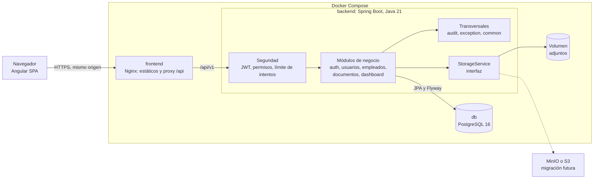
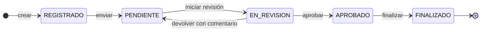

# AdminPro — Fase 1: análisis y arquitectura

**Estado:** aprobado con las recomendaciones de la sección 8 (P3 sigue abierta) · **Fecha:** 2026-11-05 · **Alcance:** Iteración 1 (MVP)

Este documento es el contrato del MVP. Una vez aprobado, cualquier cambio en endpoints, DTOs o tablas se avisa antes y se actualiza aquí. La justificación de cada decisión técnica está en [DECISIONS.md](../DECISIONS.md), citada como `D-xx`.

Contenido:

1. [Requerimientos del MVP y supuestos](#1-requerimientos-del-mvp-y-supuestos)
2. [Arquitectura](#2-arquitectura)
3. [Estructura de carpetas](#3-estructura-de-carpetas)
4. [Modelo de datos](#4-modelo-de-datos-del-mvp)
5. [Contrato de API](#5-contrato-de-api-del-mvp)
6. [Matriz de permisos revisada](#6-matriz-de-permisos-revisada)
7. [Plan de implementación](#7-plan-de-implementación)
8. [Riesgos y dudas](#8-riesgos-y-dudas)

---

## 1. Requerimientos del MVP y supuestos

### 1.1 Requerimientos

| # | Requerimiento | Terminado cuando |
|---|---|---|
| R1 | Autenticación y roles | Login con JWT de 15 min, refresh token de 7 días con rotación y revocación, bloqueo tras 5 intentos, 4 roles con permisos granulares validados en el backend |
| R2 | Empleados y organización | CRUD de empleados, activar/desactivar, departamento y cargo, historial, búsqueda y filtros, cédula y correo únicos. Gestión de departamentos y cargos |
| R3 | Gestión documental | Consecutivo `DOC-AAAA-000001` seguro ante concurrencia, categorías, responsable, vencimiento, adjuntos validados por contenido, flujo de 5 estados, historial, búsqueda |
| R4 | Dashboard | Totales, documentos por estado, próximos a vencer, actividad reciente y alertas, todo desde endpoints de agregación |
| R5 | Auditoría | Quién, qué, cuándo, valor anterior y valor nuevo en cada cambio |
| R6 | Despliegue local | Todo el sistema levanta con `docker compose up` |

Reglas transversales: listados con paginación, orden y filtros en el servidor; borrado lógico; errores en Problem Details; interfaz en español; zona horaria `America/Bogota`.

### 1.2 Fuera del MVP

Solicitudes, proveedores, inventario, informes, exportaciones, tareas `@Scheduled` y notificaciones persistentes. Sus tablas se crean en la migración de su propia iteración.

Dos consecuencias:

- Las alertas del MVP se calculan al consultar, sin tabla `notificaciones`.
- COP no aparece en el MVP porque ninguna entidad maneja dinero todavía. Entra con inventario.

### 1.3 Supuestos

Si alguno es incorrecto, dímelo al aprobar.

**Organización**

- S1. Cada usuario tiene un solo rol (`usuarios.rol_id`). Los 4 roles y sus permisos son fijos y se cargan por migración. No hay pantalla para editarlos, solo para asignar el rol a un usuario.
- S2. Un usuario puede estar vinculado a un empleado (relación 0..1), pero no todo empleado tiene usuario.
- S3. El responsable de un documento es un **empleado** activo, no un usuario, para poder asignar a personas que no entran al sistema.
- S4. Los cargos son globales: "Analista" existe una vez y sirve en cualquier departamento.
- S5. Solo se identifica con cédula de ciudadanía, de 6 a 10 dígitos, guardada como texto. Cédula de extranjería y pasaporte quedan fuera.
- S6. No se guarda salario ni otros datos sensibles del empleado, porque el MVP no los usa.

**Documentos**

- S7. "Próximo a vencer" significa dentro de 30 días, configurable por variable de entorno. "Vencido" es una condición calculada desde `fecha_vencimiento`, no un estado del flujo.
- S8. La fecha de vencimiento es opcional. No todo documento vence.
- S9. La búsqueda "por fecha" usa `fecha_documento`, la fecha propia del documento, que puede diferir de la de registro.
- S10. Máximo 10 adjuntos por documento, 10 MB cada uno. Se aceptan PDF, DOCX, XLSX, PNG, JPEG y WEBP.
- S11. Para enviar un documento a Pendiente debe tener al menos un adjunto.
- S12. Solo se editan datos y adjuntos en Registrado o Pendiente. Desde En revisión quedan congelados.

**Efectos en cascada**

- S13. Desactivar un empleado desactiva su usuario y revoca sus sesiones. Sus documentos no se reasignan solos: aparecen como alerta "responsable inactivo".
- S14. Un departamento, cargo o categoría en uso por registros activos no se puede desactivar (409).
- S15. La cédula y el correo siguen siendo únicos entre registros inactivos. Si una persona regresa, se reactiva su registro en vez de duplicarlo.

**Seguridad**

- S16. El bloqueo dura 15 minutos y se levanta solo. Restablecer la contraseña también lo levanta.
- S17. El límite de `/auth/login` es de 10 intentos por minuto por IP.
- S18. El Administrador define una contraseña temporal y el usuario debe cambiarla al primer ingreso. Mínimo 10 caracteres.

**Operación**

- S19. `docker compose up` necesita un paso previo: copiar `.env.example` a `.env`. Es la consecuencia directa de no tener secretos en el código.
- S20. Sin perfil `dev` ni `demo` no hay datos de prueba. El primer Administrador se crea desde variables de entorno al arrancar.

---

## 2. Arquitectura

Monolito modular: un solo desplegable con módulos de negocio separados (`D-01`).



Puntos clave:

- **Mismo origen.** Nginx sirve Angular y hace de proxy hacia `/api`, así el navegador ve un solo dominio y la cookie del refresh token funciona con `SameSite=Strict` (`D-08`). CORS queda restringido por variable de entorno para los casos en que el origen sea distinto.
- **Tokens.** El access token vive en memoria de Angular, nunca en `localStorage`. El refresh token viaja en una cookie `HttpOnly`, por lo que JavaScript no puede leerlo.
- **Autorización.** Cada endpoint declara `@PreAuthorize("hasAuthority('...')")`. Los guards de Angular solo ocultan interfaz.
- **Auditoría.** Se escribe en la misma transacción del cambio: si el cambio falla, tampoco queda auditoría (`D-11`).

### Versiones

Verificadas el 2026-11-05 en npm y Maven Central.

| Componente | Versión | Nota |
|---|---|---|
| Java | 21 (LTS) | |
| Spring Boot | **4.1.2** propuesto | Se aparta de tu "3.x": ver pregunta P1 |
| PostgreSQL | 16 | |
| Flyway, Hibernate, Spring Security, JUnit, Mockito | Las que fije el BOM de Spring Boot | No se fijan a mano para evitar incompatibilidades. Flyway queda en 12.4.0 |
| springdoc-openapi | 3.2.0 | Con 3.5.16 sería la línea 2.8.x |
| MapStruct | 1.6.3 | |
| Testcontainers | 2.0.5 | |
| Apache POI, OpenPDF | Se fijan en la Iteración 4 | |
| Apache Tika | 4.2.0 | Detección de tipo real de los adjuntos (`D-13`) |
| Bucket4j | 8.22.0 | Límite de intentos en login |
| Angular | **22.2.6** | Cumple "18+". Las versiones 20 y 21 ya salieron de soporte activo |
| Tailwind CSS | 4.3.4 | |
| Chart.js + ng2-charts | 4.6.1 + 11.0.0 | Única librería de gráficos (`D-15`) |
| Pruebas frontend | **Vitest** propuesto | No está en tu lista: ver pregunta P2 |
| Node.js | 22.23.2 | La que tienes instalada cumple lo que pide Angular 22 |

---

## 3. Estructura de carpetas

### Repositorio

```text
adminpro/
├── backend/
├── frontend/
├── docs/
│   └── fase-1-analisis-y-arquitectura.md
├── .github/workflows/ci.yml
├── docker-compose.yml
├── .env.example
├── PROGRESS.md
├── DECISIONS.md
├── LICENSE
└── README.md
```

### Backend

Cada módulo de negocio repite las mismas capas. Se muestra `documentos` completo.

```text
backend/
├── Dockerfile
├── pom.xml
└── src/
    ├── main/
    │   ├── java/com/adminpro/
    │   │   ├── AdminProApplication.java
    │   │   ├── auth/                  # login, refresh, logout, cambio de contraseña
    │   │   ├── usuarios/              # usuarios, roles y permisos
    │   │   ├── empleados/             # empleados, departamentos y cargos
    │   │   ├── documentos/
    │   │   │   ├── controller/
    │   │   │   ├── service/           # incluye ConsecutivoService y FlujoDocumento
    │   │   │   ├── repository/
    │   │   │   ├── entity/
    │   │   │   ├── dto/
    │   │   │   └── mapper/
    │   │   ├── dashboard/             # solo controller, service, repository y dto
    │   │   ├── security/              # configuración, JWT, límite de intentos
    │   │   ├── config/                # OpenAPI, CORS, Jackson, propiedades
    │   │   ├── exception/             # manejador global y excepciones de negocio
    │   │   ├── audit/                 # AuditService, entidad y consulta de auditoría
    │   │   ├── storage/               # StorageService, LocalStorageService, validación
    │   │   └── common/                # BaseEntity, PageResponse, utilidades
    │   └── resources/
    │       ├── application.yml
    │       ├── application-dev.yml
    │       ├── application-demo.yml
    │       ├── application-prod.yml
    │       └── db/
    │           ├── migration/         # V1__..., V2__...: esquema, todos los perfiles
    │           └── seed/              # R__datos_prueba.sql: solo dev y demo
    └── test/java/com/adminpro/
        ├── support/                   # base de Testcontainers y fábricas de datos
        ├── empleados/                 # pruebas unitarias e integración por módulo
        ├── documentos/
        └── security/                  # matriz de permisos: endpoint x rol
```

`storage` se agrega a los paquetes transversales que definiste porque lo usarán varios módulos, y `dashboard` porque solo agrega datos y no tiene entidades propias.

### Frontend

```text
frontend/
├── Dockerfile
├── nginx.conf
├── angular.json
├── package.json
└── src/
    ├── styles.css                     # tokens de diseño, tema claro y oscuro
    └── app/
        ├── app.config.ts
        ├── app.routes.ts              # rutas con lazy loading por módulo
        ├── core/
        │   ├── auth/                  # AuthService con signals
        │   ├── guards/                # autenticación y permisos
        │   ├── interceptors/          # token, refresh y errores
        │   └── services/              # tema y toasts
        ├── shared/
        │   ├── components/            # botón, input, tabla, modal, toast, badge,
        │   │                          # estado vacío, skeleton, confirmación, paginador
        │   ├── directives/            # *tienePermiso
        │   ├── pipes/                 # fecha Bogotá, estado de documento
        │   └── validators/            # cédula y otros
        ├── layouts/
        │   ├── main-layout/           # sidebar, encabezado, breadcrumbs
        │   └── auth-layout/
        ├── features/
        │   ├── auth/
        │   ├── dashboard/
        │   ├── empleados/             # incluye departamentos y cargos
        │   ├── documentos/
        │   ├── usuarios/
        │   └── auditoria/
        └── models/                    # interfaces iguales a los DTOs del backend
```

---

## 4. Modelo de datos del MVP

Convenciones (`D-05`, `D-06`, `D-07`):

- Tablas en español, en plural y `snake_case`.
- Claves primarias `BIGINT GENERATED ALWAYS AS IDENTITY`.
- Estados como `VARCHAR` con `CHECK`.
- Fechas con hora en `TIMESTAMPTZ`; fechas de calendario en `DATE`.

Todas las tablas llevan `created_at`, `updated_at`, `created_by` y `updated_by`. Se omiten del diagrama para que se pueda leer. `created_by` y `updated_by` son claves foráneas a `usuarios`, nulas cuando la acción la hace el sistema.

```mermaid
erDiagram
    roles ||--o{ usuarios : "asigna"
    roles ||--o{ rol_permisos : "tiene"
    permisos ||--o{ rol_permisos : "incluido en"
    usuarios ||--o{ refresh_tokens : "abre"
    empleados |o--o| usuarios : "accede como"
    departamentos ||--o{ empleados : "agrupa"
    cargos ||--o{ empleados : "clasifica"
    categorias_documento ||--o{ documentos : "clasifica"
    empleados ||--o{ documentos : "es responsable de"
    documentos ||--o{ documento_adjuntos : "contiene"
    documentos ||--o{ documento_historial : "registra"
    usuarios ||--o{ auditoria : "genera"

    roles {
        bigint id PK
        varchar codigo UK
        varchar nombre
        varchar descripcion
    }
    permisos {
        bigint id PK
        varchar codigo UK
        varchar modulo
        varchar descripcion
    }
    rol_permisos {
        bigint rol_id PK, FK
        bigint permiso_id PK, FK
    }
    usuarios {
        bigint id PK
        varchar correo UK
        varchar password_hash
        varchar nombre_visible
        bigint rol_id FK
        bigint empleado_id FK, UK
        boolean activo
        boolean debe_cambiar_password
        smallint intentos_fallidos
        timestamptz bloqueado_hasta
        timestamptz ultimo_acceso_at
        bigint version
    }
    refresh_tokens {
        bigint id PK
        bigint usuario_id FK
        char token_hash UK
        uuid familia_id
        timestamptz expira_at
        timestamptz revocado_at
        varchar ip
        varchar user_agent
    }
    departamentos {
        bigint id PK
        varchar nombre UK
        varchar descripcion
        boolean activo
        bigint version
    }
    cargos {
        bigint id PK
        varchar nombre UK
        varchar descripcion
        boolean activo
        bigint version
    }
    empleados {
        bigint id PK
        varchar cedula UK
        varchar nombres
        varchar apellidos
        varchar correo UK
        varchar telefono
        date fecha_ingreso
        bigint departamento_id FK
        bigint cargo_id FK
        boolean activo
        bigint version
    }
    categorias_documento {
        bigint id PK
        varchar nombre UK
        varchar descripcion
        boolean activo
        bigint version
    }
    documentos {
        bigint id PK
        varchar consecutivo UK
        varchar titulo
        text descripcion
        bigint categoria_id FK
        bigint responsable_id FK
        varchar estado
        date fecha_documento
        date fecha_vencimiento
        boolean activo
        bigint version
    }
    documento_adjuntos {
        bigint id PK
        bigint documento_id FK
        varchar nombre_original
        uuid storage_key UK
        varchar tipo_mime
        bigint tamano_bytes
        char sha256
        boolean activo
    }
    documento_historial {
        bigint id PK
        bigint documento_id FK
        varchar accion
        varchar estado_anterior
        varchar estado_nuevo
        text comentario
    }
    auditoria {
        bigint id PK
        varchar entidad
        bigint entidad_id
        varchar accion
        jsonb valor_anterior
        jsonb valor_nuevo
        varchar ip
    }
    secuencias_consecutivo {
        varchar tipo PK
        smallint anio PK
        bigint ultimo_valor
    }
```



### Descripción de las tablas

| Tabla | Propósito | Restricciones e índices principales |
|---|---|---|
| `roles` | Los 4 roles fijos | `codigo` único |
| `permisos` | Permisos granulares, como `EMPLEADOS_LEER` | `codigo` único |
| `rol_permisos` | Relación N:M entre roles y permisos | PK compuesta |
| `usuarios` | Cuentas de acceso y estado de bloqueo | Único sobre `lower(correo)`; `empleado_id` único; índice en `rol_id` |
| `refresh_tokens` | Sesiones. Guarda el hash SHA-256, nunca el token (`D-10`) | `token_hash` único; índices en `usuario_id` y `familia_id` |
| `departamentos` | Catálogo organizacional | `nombre` único sin distinguir mayúsculas |
| `cargos` | Catálogo de cargos | `nombre` único sin distinguir mayúsculas |
| `empleados` | Datos laborales | `CHECK` de cédula `^[0-9]{6,10}$`; únicos en `cedula` y `lower(correo)`; índices en `departamento_id`, `cargo_id`, `activo`; índice de trigramas para nombre |
| `categorias_documento` | Catálogo de categorías | `nombre` único sin distinguir mayúsculas |
| `documentos` | Registro documental | `consecutivo` único; `CHECK` de `estado`; índices en `estado`, `categoria_id`, `responsable_id`, `fecha_documento`, `fecha_vencimiento` |
| `documento_adjuntos` | Metadatos del archivo; el contenido va en el `StorageService` | `storage_key` único; `CHECK tamano_bytes BETWEEN 1 AND 10485760`; índice en `documento_id` |
| `documento_historial` | Línea de tiempo de negocio del documento. Solo inserción | `CHECK` de `accion`; índice en `(documento_id, created_at)` |
| `auditoria` | Registro técnico de cambios. Solo inserción. El quién y el cuándo son `created_by` y `created_at` | Índices en `(entidad, entidad_id)`, `created_by`, `created_at` |
| `secuencias_consecutivo` | Último número usado por tipo y año (`D-12`) | PK `(tipo, anio)` |

**Por qué hay dos historiales.** `documento_historial` responde "¿qué pasó con este documento?" en lenguaje de negocio, con comentarios. `auditoria` guarda la diferencia técnica de cualquier entidad. El historial de empleados no necesita tabla propia: es una consulta filtrada sobre `auditoria` (`D-11`).

**Búsqueda sin tildes.** Buscar "gomez" debe encontrar "Gómez", así que se usan las extensiones `unaccent` y `pg_trgm`.

### Flujo de estados de un documento



| Transición | Permiso | Regla |
|---|---|---|
| Registrado → Pendiente | `DOCUMENTOS_ESCRIBIR` | Debe tener al menos un adjunto |
| Pendiente → En revisión | `DOCUMENTOS_APROBAR` | |
| En revisión → Aprobado | `DOCUMENTOS_APROBAR` | Quien creó el documento no puede aprobarlo (propuesto, ver P5) |
| En revisión → Pendiente | `DOCUMENTOS_APROBAR` | Comentario obligatorio (propuesto, ver P5) |
| Aprobado → Finalizado | `DOCUMENTOS_APROBAR` | Finalizado es definitivo |

Cualquier otra transición responde 409. Tu flujo era lineal y no decía qué pasa si el revisor no aprueba, por eso propongo la devolución sin agregar estados.

---

## 5. Contrato de API del MVP

### 5.1 Convenciones

- **Prefijo:** `/api/v1`. Todas las rutas siguientes lo incluyen.
- **Autenticación:** `Authorization: Bearer <accessToken>`, excepto donde se indique. Las respuestas `401` y `403` aplican a todo endpoint protegido.
- **Paginación:** `?page=0&size=20&sort=campo,asc`. `size` máximo 100. Solo se ordena por campos permitidos.
- **Concurrencia optimista:** los `PUT` y las transiciones envían `version`. Si el registro cambió, la respuesta es 409 (`D-09`).
- **Fechas:** `YYYY-MM-DD` en fechas de calendario. ISO 8601 con desfase en fechas con hora.

Respuesta paginada única:

```json
{
  "content": [],
  "page": 0,
  "size": 20,
  "totalElements": 0,
  "totalPages": 0
}
```

Error único (Problem Details, RFC 9457):

```json
{
  "type": "https://adminpro.dev/errores/validacion",
  "title": "Datos inválidos",
  "status": 400,
  "detail": "La solicitud contiene errores de validación.",
  "instance": "/api/v1/empleados",
  "code": "VALIDACION",
  "errors": [
    { "field": "cedula", "message": "Debe tener entre 6 y 10 dígitos" }
  ]
}
```

| Código | Uso |
|---|---|
| 200 / 201 / 204 | Consulta o acción correcta / creación con cabecera `Location` / sin contenido |
| 400 | Validación o formato inválido |
| 401 | Sin autenticar, token vencido o credenciales inválidas |
| 403 | Sin permiso, o regla de separación de funciones |
| 404 | Recurso inexistente |
| 405 | Método HTTP no admitido por la ruta |
| 409 | Duplicado, transición inválida, `version` desactualizada o recurso en uso |
| 413 | Adjunto mayor a 10 MB |
| 415 | Tipo real de archivo no permitido |
| 429 | Demasiados intentos en login |

Login responde el mismo 401 si el correo no existe, la contraseña es incorrecta o la cuenta está bloqueada, para no revelar qué cuentas existen.

Roles: **A** Administrador, **S** Supervisor, **X** Auxiliar, **C** Consulta.

### 5.2 Autenticación

| Método | Ruta | Permiso / Roles | Descripción | Éxito | Errores propios |
|---|---|---|---|---|---|
| POST | `/auth/login` | Público | Inicia sesión, entrega el access token y fija la cookie del refresh token | 200 | 401, 429 |
| POST | `/auth/refresh` | Cookie | Rota el refresh token y entrega un nuevo access token | 200 | 401 |
| POST | `/auth/logout` | Cookie | Revoca la sesión y borra la cookie | 204 | |
| GET | `/auth/me` | Autenticado | Usuario actual y sus permisos | 200 | |
| POST | `/auth/cambiar-password` | Autenticado | Cambia la contraseña y revoca las demás sesiones | 204 | 400 |

Con `debe_cambiar_password` activo, el backend rechaza con 403 todo lo que no sea `/auth/cambiar-password`, `/auth/logout` y `/auth/me`. Después de cambiarla, el cliente llama a `/auth/refresh` para obtener un token sin esa restricción.

### 5.3 Usuarios y roles

| Método | Ruta | Permiso / Roles | Descripción | Éxito | Errores propios |
|---|---|---|---|---|---|
| GET | `/usuarios` | `USUARIOS_LEER` / A | Lista. Filtros: `q`, `rolId`, `activo` | 200 | |
| GET | `/usuarios/{id}` | `USUARIOS_LEER` / A | Detalle | 200 | 404 |
| POST | `/usuarios` | `USUARIOS_ESCRIBIR` / A | Crea con contraseña temporal | 201 | 400, 409 |
| PUT | `/usuarios/{id}` | `USUARIOS_ESCRIBIR` / A | Edita nombre, rol y empleado vinculado | 200 | 400, 404, 409 |
| POST | `/usuarios/{id}/restablecer-password` | `USUARIOS_ESCRIBIR` / A | Define contraseña temporal, desbloquea y revoca sesiones | 204 | 400, 404 |
| PATCH | `/usuarios/{id}/activar` | `USUARIOS_DESACTIVAR` / A | Reactiva | 200 | 404 |
| PATCH | `/usuarios/{id}/desactivar` | `USUARIOS_DESACTIVAR` / A | Desactiva y revoca sesiones. No se permite sobre uno mismo ni sobre el último Administrador activo | 200 | 404, 409 |
| GET | `/roles` | `USUARIOS_LEER` / A | Roles con sus permisos. Solo lectura | 200 | |

### 5.4 Empleados

| Método | Ruta | Permiso / Roles | Descripción | Éxito | Errores propios |
|---|---|---|---|---|---|
| GET | `/empleados` | `EMPLEADOS_LEER` / A S X C | Lista. Filtros: `q` (nombre, cédula, correo), `departamentoId`, `cargoId`, `activo` | 200 | |
| GET | `/empleados/{id}` | `EMPLEADOS_LEER` / A S X C | Detalle | 200 | 404 |
| POST | `/empleados` | `EMPLEADOS_ESCRIBIR` / A S X | Crea | 201 | 400, 409 |
| PUT | `/empleados/{id}` | `EMPLEADOS_ESCRIBIR` / A S X | Edita, incluidos departamento y cargo | 200 | 400, 404, 409 |
| PATCH | `/empleados/{id}/activar` | `EMPLEADOS_DESACTIVAR` / A | Reactiva | 200 | 404 |
| PATCH | `/empleados/{id}/desactivar` | `EMPLEADOS_DESACTIVAR` / A | Desactiva junto con su usuario | 200 | 404 |
| GET | `/empleados/{id}/historial` | `EMPLEADOS_LEER` / A S X C | Cambios del empleado, paginados | 200 | 404 |

### 5.5 Catálogos

`{catalogo}` es `departamentos`, `cargos` o `categorias-documento`. Los tres tienen las mismas operaciones.

| Método | Ruta | Permiso / Roles | Descripción | Éxito | Errores propios |
|---|---|---|---|---|---|
| GET | `/{catalogo}` | `EMPLEADOS_LEER` o `DOCUMENTOS_LEER` según el catálogo / A S X C | Lista. Filtros: `q`, `activo` | 200 | |
| GET | `/{catalogo}/{id}` | Igual que el anterior / A S X C | Detalle | 200 | 404 |
| POST | `/{catalogo}` | `CATALOGOS_ESCRIBIR` / A | Crea | 201 | 400, 409 |
| PUT | `/{catalogo}/{id}` | `CATALOGOS_ESCRIBIR` / A | Edita | 200 | 400, 404, 409 |
| PATCH | `/{catalogo}/{id}/activar` | `CATALOGOS_ESCRIBIR` / A | Reactiva | 200 | 404 |
| PATCH | `/{catalogo}/{id}/desactivar` | `CATALOGOS_ESCRIBIR` / A | Desactiva si no está en uso | 200 | 404, 409 |

### 5.6 Documentos

| Método | Ruta | Permiso / Roles | Descripción | Éxito | Errores propios |
|---|---|---|---|---|---|
| GET | `/documentos` | `DOCUMENTOS_LEER` / A S X C | Lista. Filtros: `consecutivo`, `q`, `categoriaId`, `estado`, `responsableId`, `fechaDesde`, `fechaHasta`, `venceHasta`, `activo` | 200 | |
| GET | `/documentos/{id}` | `DOCUMENTOS_LEER` / A S X C | Detalle con adjuntos y acciones disponibles para el usuario | 200 | 404 |
| POST | `/documentos` | `DOCUMENTOS_ESCRIBIR` / A S X | Crea en Registrado y asigna el consecutivo | 201 | 400 |
| PUT | `/documentos/{id}` | `DOCUMENTOS_ESCRIBIR` / A S X | Edita en Registrado o Pendiente | 200 | 400, 404, 409 |
| POST | `/documentos/{id}/enviar` | `DOCUMENTOS_ESCRIBIR` / A S X | Registrado → Pendiente | 200 | 404, 409 |
| POST | `/documentos/{id}/iniciar-revision` | `DOCUMENTOS_APROBAR` / A S | Pendiente → En revisión | 200 | 404, 409 |
| POST | `/documentos/{id}/aprobar` | `DOCUMENTOS_APROBAR` / A S | En revisión → Aprobado | 200 | 403, 404, 409 |
| POST | `/documentos/{id}/devolver` | `DOCUMENTOS_APROBAR` / A S | En revisión → Pendiente, con comentario | 200 | 400, 404, 409 |
| POST | `/documentos/{id}/finalizar` | `DOCUMENTOS_APROBAR` / A S | Aprobado → Finalizado | 200 | 404, 409 |
| PATCH | `/documentos/{id}/activar` | `DOCUMENTOS_DESACTIVAR` / A | Reactiva | 200 | 404 |
| PATCH | `/documentos/{id}/desactivar` | `DOCUMENTOS_DESACTIVAR` / A | Desactiva | 200 | 404 |
| GET | `/documentos/{id}/historial` | `DOCUMENTOS_LEER` / A S X C | Línea de tiempo, paginada | 200 | 404 |
| GET | `/documentos/{id}/adjuntos` | `DOCUMENTOS_LEER` / A S X C | Lista de adjuntos activos | 200 | 404 |
| POST | `/documentos/{id}/adjuntos` | `DOCUMENTOS_ESCRIBIR` / A S X | Sube un archivo (`multipart/form-data`, campo `archivo`) | 201 | 404, 409, 413, 415 |
| GET | `/documentos/{id}/adjuntos/{adjuntoId}/descarga` | `DOCUMENTOS_LEER` / A S X C | Descarga el archivo | 200 | 404 |
| DELETE | `/documentos/{id}/adjuntos/{adjuntoId}` | `DOCUMENTOS_ESCRIBIR` / A S X | Borrado lógico del adjunto | 204 | 404, 409 |

Cada transición tiene su propia ruta para que `@PreAuthorize` sea explícito y la prueba de permisos sea directa.

### 5.7 Dashboard

| Método | Ruta | Permiso / Roles | Descripción | Éxito |
|---|---|---|---|---|
| GET | `/dashboard/resumen` | `DASHBOARD_LEER` / A S X C | Empleados activos e inactivos, documentos activos, por vencer y vencidos | 200 |
| GET | `/dashboard/documentos-por-estado` | `DASHBOARD_LEER` / A S X C | Conteo por estado | 200 |
| GET | `/dashboard/documentos-por-vencer` | `DASHBOARD_LEER` / A S X C | Lista paginada. Parámetro `dias`, por defecto 30 | 200 |
| GET | `/dashboard/actividad-reciente` | `DASHBOARD_LEER` / A S X C | Eventos sin valores anteriores ni nuevos. Parámetro `limite`, máximo 50 | 200 |
| GET | `/dashboard/alertas` | `DASHBOARD_LEER` / A S X C | Documentos vencidos, por vencer y con responsable inactivo | 200 |

### 5.8 Auditoría y operación

| Método | Ruta | Permiso / Roles | Descripción | Éxito | Errores propios |
|---|---|---|---|---|---|
| GET | `/auditoria` | `AUDITORIA_LEER` / A S | Lista. Filtros: `entidad`, `entidadId`, `usuarioId`, `accion`, `desde`, `hasta` | 200 | |
| GET | `/auditoria/{id}` | `AUDITORIA_LEER` / A S | Detalle con valor anterior y nuevo | 200 | 404 |
| GET | `/actuator/health` (sin prefijo) | Público | Estado del servicio para Docker | 200 | |
| GET | `/swagger-ui.html` (sin prefijo) | Público en `dev` y `demo`, apagado en `prod` | Documentación interactiva | 200 | |

### 5.9 DTOs

`?` indica opcional. Las validaciones son las mismas en base de datos, backend y frontend.

**Auth**

| DTO | Campos |
|---|---|
| `LoginRequest` | `correo` (correo válido), `password` (obligatorio) |
| `TokenResponse` | `accessToken`, `expiresIn`, `usuario: UsuarioActualResponse` |
| `UsuarioActualResponse` | `id`, `correo`, `nombreVisible`, `rol`, `permisos: string[]`, `debeCambiarPassword` |
| `CambiarPasswordRequest` | `passwordActual`, `passwordNueva` (10 a 72 caracteres) |

**Usuarios**

| DTO | Campos |
|---|---|
| `UsuarioCreateRequest` | `correo`, `nombreVisible` (máx. 120), `rolId`, `empleadoId?`, `passwordTemporal` (10 a 72) |
| `UsuarioUpdateRequest` | `nombreVisible`, `rolId`, `empleadoId?`, `version` |
| `RestablecerPasswordRequest` | `passwordTemporal` (10 a 72) |
| `UsuarioResponse` | `id`, `correo`, `nombreVisible`, `rol: RefResponse`, `empleado?: RefResponse`, `activo`, `bloqueadoHasta?`, `ultimoAccesoAt?`, `version` |
| `RolResponse` | `id`, `codigo`, `nombre`, `permisos: string[]` |

**Empleados y catálogos**

| DTO | Campos |
|---|---|
| `EmpleadoRequest` | `cedula` (6 a 10 dígitos), `nombres` (máx. 100), `apellidos` (máx. 100), `correo` (máx. 150), `telefono?` (10 dígitos), `fechaIngreso` (no futura), `departamentoId`, `cargoId`, `version?` (obligatoria en `PUT`) |
| `EmpleadoResponse` | Los campos anteriores más `id`, `departamento: RefResponse`, `cargo: RefResponse`, `activo`, `createdAt`, `updatedAt` |
| `CatalogoRequest` | `nombre` (máx. 100), `descripcion?` (máx. 255), `version?` (obligatoria en `PUT`) |
| `CatalogoResponse` | `id`, `nombre`, `descripcion?`, `activo`, `version` |
| `RefResponse` | `id`, `nombre` |

**Documentos**

| DTO | Campos |
|---|---|
| `DocumentoRequest` | `titulo` (máx. 200), `descripcion?` (máx. 2000), `categoriaId`, `responsableId`, `fechaDocumento`, `fechaVencimiento?` (no anterior a `fechaDocumento`), `version?` (obligatoria en `PUT`) |
| `DocumentoListItemResponse` | `id`, `consecutivo`, `titulo`, `categoria: RefResponse`, `responsable: RefResponse`, `estado`, `fechaDocumento`, `fechaVencimiento?`, `vencido`, `activo` |
| `DocumentoResponse` | Lo anterior más `descripcion?`, `adjuntos: AdjuntoResponse[]`, `accionesDisponibles: string[]`, `version`, `createdAt`, `updatedAt` |
| `TransicionRequest` | `version`, `comentario?` (máx. 1000, obligatorio al devolver) |
| `AdjuntoResponse` | `id`, `nombreOriginal`, `tipoMime`, `tamanoBytes`, `createdAt` |
| `HistorialDocumentoResponse` | `id`, `accion`, `estadoAnterior?`, `estadoNuevo?`, `comentario?`, `usuario?: RefResponse`, `createdAt` |

**Dashboard y auditoría**

| DTO | Campos |
|---|---|
| `ResumenResponse` | `empleadosActivos`, `empleadosInactivos`, `documentosActivos`, `documentosPorVencer`, `documentosVencidos` |
| `ConteoEstadoResponse` | `estado`, `total` |
| `ActividadResponse` | `accion`, `entidad`, `etiqueta`, `usuario?`, `fecha` |
| `AlertaResponse` | `tipo`, `severidad`, `mensaje`, `entidad`, `entidadId` |
| `AuditoriaResponse` | `id`, `entidad`, `entidadId`, `accion`, `valorAnterior?`, `valorNuevo?`, `usuario?: RefResponse`, `ip?`, `createdAt` |

Los campos sensibles, como `password_hash` y `token_hash`, nunca llegan a `auditoria` ni a ningún DTO.

---

## 6. Matriz de permisos revisada

**L** leer, **E** crear/editar, **D** desactivar. Los cambios frente a tu matriz están en **negrita**.

| Módulo | Administrador | Supervisor | Auxiliar | Consulta |
|---|---|---|---|---|
| Dashboard | L | L | L | L |
| Empleados | L E D | **L E** | L E | L |
| Catálogos (departamentos, cargos, categorías) | **L E D** | **L** | **L** | **L** |
| Documentos | L E D **+ aprobar** | L E + aprobar | L E | L |
| Solicitudes (Iter. 2) | L E D | L E + asignar | **L de todas, E de las propias** | L |
| Proveedores (Iter. 2) | L E D | **L E** | L E | L |
| Inventario (Iter. 3) | L E D | **L E** | L E | L |
| Informes (Iter. 4) | L + exportar | L + exportar | **L** | L |
| Usuarios y roles | L E D | — | — | — |
| Auditoría | L | L | — | — |

### Inconsistencias encontradas

| # | Problema en la matriz base | Ajuste propuesto |
|---|---|---|
| 1 | El Supervisor solo leía empleados, proveedores e inventario, mientras el Auxiliar, de menor rango, sí podía editarlos | Supervisor pasa a L E |
| 2 | El Auxiliar no veía informes, pero Consulta, el rol más limitado, sí | Auxiliar pasa a L, sin exportar |
| 3 | Departamentos, cargos y categorías no tenían fila | Nueva fila: solo el Administrador los modifica, porque cambian la estructura de la empresa |
| 4 | No estaba dicho que el Administrador pudiera aprobar. Sin eso, un Supervisor ausente bloquea el flujo | Administrador aprueba |
| 5 | "L E (propias)" en Solicitudes era ambiguo: ¿el Auxiliar ve menos que Consulta? | Lee todas y edita solo las propias |
| 6 | Todos ven actividad reciente en el dashboard, pero esos datos salen de Auditoría, que Auxiliar y Consulta no pueden leer | La actividad reciente expone solo quién, acción, entidad y fecha, sin valores. Excluye eventos de usuarios y de sesión |
| 7 | Quien lee un empleado ve su historial, que sale de `auditoria` | Es intencional: `/empleados/{id}/historial` usa `EMPLEADOS_LEER` y solo devuelve campos que ese lector ya puede ver |

### Permisos y roles del MVP

Los de las iteraciones siguientes se crean en la migración de cada una.

| Permiso | A | S | X | C |
|---|:-:|:-:|:-:|:-:|
| `DASHBOARD_LEER` | ✓ | ✓ | ✓ | ✓ |
| `EMPLEADOS_LEER` | ✓ | ✓ | ✓ | ✓ |
| `EMPLEADOS_ESCRIBIR` | ✓ | ✓ | ✓ | |
| `EMPLEADOS_DESACTIVAR` | ✓ | | | |
| `CATALOGOS_ESCRIBIR` | ✓ | | | |
| `DOCUMENTOS_LEER` | ✓ | ✓ | ✓ | ✓ |
| `DOCUMENTOS_ESCRIBIR` | ✓ | ✓ | ✓ | |
| `DOCUMENTOS_APROBAR` | ✓ | ✓ | | |
| `DOCUMENTOS_DESACTIVAR` | ✓ | | | |
| `USUARIOS_LEER` | ✓ | | | |
| `USUARIOS_ESCRIBIR` | ✓ | | | |
| `USUARIOS_DESACTIVAR` | ✓ | | | |
| `AUDITORIA_LEER` | ✓ | ✓ | | |

---

## 7. Plan de implementación

Ninguna fase empieza sin tu aprobación de la anterior.

| Fase | Entregable | Criterio de aceptación |
|---|---|---|
| **1. Análisis y arquitectura** | Este documento, `PROGRESS.md`, `DECISIONS.md` | Lo apruebas y resuelves P1 a P6 |
| **2. Base de datos** | Diagrama ER final, migraciones Flyway, datos de prueba | Las migraciones corren limpias en un PostgreSQL 16 vacío, con y sin datos de prueba. Una segunda ejecución no hace cambios |
| **3. Backend base** | Proyecto Spring Boot, conexión, errores Problem Details, Swagger, Docker | `docker compose up` levanta API y base de datos, Swagger es accesible y `/actuator/health` responde `UP` |
| **4. Seguridad** | Login, refresh, roles, permisos, auditoría, usuarios | Las pruebas de permisos pasan para los 4 roles. Hay pruebas de rotación, reutilización de token, bloqueo y límite de intentos |
| **5. Frontend base** | Sistema de diseño, layout, login, guards, interceptors | El login funciona contra el backend, con tema claro y oscuro y renovación automática del token |
| **6. Módulos del MVP** | Empleados, catálogos, documentos, dashboard, pantallas de usuarios y auditoría | CRUD probado de punta a punta. La matriz de permisos cubre todos los endpoints. Prueba de concurrencia del consecutivo sin duplicados ni huecos. Cobertura de servicios de al menos 70 % |
| **7. CI y documentación** | GitHub Actions, README, despliegue | El pipeline pasa y el demo en vivo es accesible con un usuario por rol |
| **8+. Iteraciones 2 a 4** | Solicitudes, proveedores, inventario, informes, automatizaciones | Los mismos criterios, aplicados a cada módulo |

**Prerrequisito desde la Fase 3** (ver P4): Docker Desktop. JDK 21 ya está instalado.

**Cierre de cada fase:** comandos exactos de verificación, tu confirmación de la salida, `PROGRESS.md` y `DECISIONS.md` actualizados, y commits en formato Conventional Commits.

---

## 8. Riesgos y dudas

### 8.1 Preguntas que bloquean la Fase 2

Cada una trae mi recomendación. Basta con que respondas "de acuerdo" o me digas qué cambiar.

**P1. ¿Spring Boot 4.1 o 3.5?**
Pediste 3.x, pero toda esa línea perdió el soporte OSS el 30 de junio de 2026. La 3.5.16 fue la última versión y Spring recomienda pasar a 4.0 o 4.1.
- **Recomiendo 4.1.2.** Un proyecto nuevo arranca con parches de seguridad y demuestra que estás al día. El costo es que hay menos tutoriales, porque cambian Spring Security 7 y Jackson 3.
- **Alternativa: 3.5.16.** Cumple tu texto literal y tiene más ejemplos, pero en una entrevista tendrías que explicar por qué empezaste en una versión sin soporte.

El contrato de este documento no cambia en ninguno de los dos casos.

**P2. ¿Vitest para las pruebas del frontend?**
Listaste Jasmine/Karma o Jest. Angular 22 genera proyectos con Vitest por defecto.
- **Recomiendo Vitest:** es la opción oficial y evita configuración extra.
- **Alternativa dentro de tu lista: Jest** con `jest-preset-angular` 17, que es compatible con Angular 22 pero requiere configurarlo aparte.

**P3. ¿Qué hacemos con el repositorio Git?**
Esta carpeta tiene un `.git` con un único commit de otro proyecto, *Football AI Predictor*, con sus 132 archivos borrados del disco y **sin remoto configurado**. Si ese proyecto no está en otro lugar, este `.git` es la única copia. No toqué nada.
- **Recomiendo:** primero guardas ese proyecto (un `git bundle` o un repositorio propio en GitHub) y después iniciamos un repositorio limpio. Así AdminPro no arranca su historial con un proyecto ajeno.
- ¿Tienes copia de Football AI Predictor en otro lado?

**P4. ¿Puedes instalar Docker Desktop?**
Docker no está instalado. Sin él no se pueden correr Testcontainers ni `docker compose up`, así que hace falta desde la Fase 3.

*Corrección:* la primera versión de este documento decía que faltaba JDK 21. Está instalado en `C:\Program Files\Eclipse Adoptium\jdk-21.0.6.7-hotspot` y en `C:\Program Files\Java\jdk-21.0.10`; lo que pasa es que el `PATH` apunta a Java 17. Hay que cambiar `JAVA_HOME` antes de compilar. Maven 3.9.11, Node 22.23.2 y npm ya están bien.

**P5. ¿Apruebas los dos cambios al flujo de documentos?**
1. Devolución En revisión → Pendiente, con comentario obligatorio.
2. Quien creó un documento no puede aprobarlo, aunque sea Administrador. Es un control típico de auditoría. Implica que debe haber al menos dos personas con permiso de aprobar, o una distinta del creador.

**P6. ¿Apruebas la matriz de permisos revisada?**
Sobre todo el ajuste 1. Si el Supervisor era de solo lectura a propósito, para separar quien opera de quien supervisa, lo dejo como estaba.

### 8.2 Preguntas que no bloquean

**P7. Columnas de auditoría en tablas de solo inserción.**
Pediste las cuatro columnas en todas las tablas, y así está modelado. En `auditoria` y `documento_historial`, `updated_at` y `updated_by` nunca cambian, y en `rol_permisos` aportan poco. Propongo exceptuarlas. Si no respondes, cumplo tu regla literal.

**P8. ¿Ejecuto yo los comandos de verificación?**
Tu regla 3 dice que me pegues la salida. En este entorno puedo ejecutarlos yo y mostrarte el resultado real, y escribir los archivos directamente en el repositorio. Si prefieres correrlos tú, mantengo la regla como está. Si no respondes, sigo tu regla.

**P9. Demo en vivo (se decide en la Fase 7).**
Hay tres tensiones con lo que pediste:

- Tus datos de prueba corren "solo en dev", pero el demo necesita usuarios de prueba. Propongo un perfil `demo` que también los cargue.
- El README no debe tener credenciales reales y sí usuarios de prueba. Las contraseñas del demo son ficticias y solo sirven allí, así que no entran en conflicto.
- Un demo público con credenciales publicadas permite a cualquiera subir archivos o cambiar contraseñas. El perfil `demo` debe bloquear esos cambios en las cuentas de prueba, limitar los adjuntos y restaurar los datos cada noche.

Propuesta de hosting, por validar en la Fase 7 porque los planes gratuitos cambian y las fuentes consultadas se contradicen:

| Opción | Backend y frontend | Base de datos | A favor | En contra |
|---|---|---|---|---|
| **Gratuita (recomendada para empezar)** | Una imagen en Render o Koyeb, con Angular servido por Spring Boot | Neon | Sin costo, y la base de datos no expira | Se duerme por inactividad, memoria justa para Spring Boot, disco efímero |
| **Económica** | VPS pequeño con el mismo `docker compose` | Contenedor en el VPS | Igual a local, sin arranque en frío, volumen persistente | Costo mensual y administrar el servidor |

El disco efímero es aceptable para un demo que se restaura a diario. Evito el plan gratuito de PostgreSQL de Render porque expira.

### 8.3 Riesgos técnicos

| Riesgo | Impacto | Mitigación |
|---|---|---|
| Alcance grande para una persona | Dejar el MVP a medias, justo lo que quieres evitar | Fases con criterio de cierre; nada de iteraciones 2 a 4 antes de cerrar la Fase 7 |
| Detección de DOCX y XLSX | Son archivos ZIP. Con `tika-core` solo se detectan como ZIP, y se rechazarían archivos válidos o se aceptaría cualquier ZIP | Incluir el módulo de Tika para formatos de Office, con pruebas de archivos válidos y falsificados |
| Fallo entre disco y base de datos al subir un adjunto | Archivos huérfanos | Guardar el archivo antes del commit y borrarlo si la transacción falla |
| Dos pestañas renuevan el token a la vez | Una parece reutilización de token y cierra la sesión | Una sola renovación en curso por pestaña y una ventana de gracia corta en el backend |
| Permisos dentro del JWT | Un cambio de rol tarda hasta 15 minutos en aplicar | Aceptado por la corta duración. Desactivar un usuario revoca sus refresh tokens |
| Bloqueo por intentos fallidos | Un atacante puede bloquear una cuenta ajena | Es temporal y el límite por IP lo reduce |
| Límite de intentos en memoria | Solo funciona con una instancia, y detrás de un proxy depende de la IP real | Suficiente para el alcance. Configurar cabeceras reenviadas; Redis si se escala |
| Datos personales (Ley 1581 de 2012) | Cédula, correo y teléfono son datos personales, aunque aquí sean ficticios | Datos ficticios, sin valores sensibles en logs. Si fuera un sistema real, faltaría política de tratamiento y enmascarar la cédula en Consulta |
| Fuentes de hosting contradictorias | La propuesta podría cambiar | Validar con la documentación oficial en la Fase 7 |
